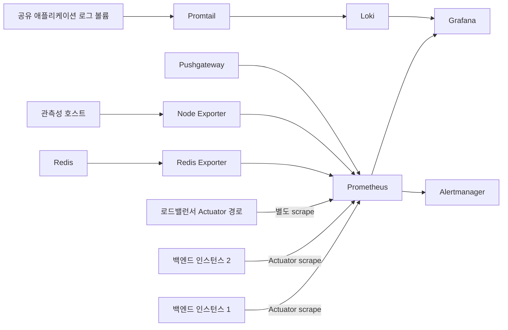

# 관측성 구성요소의 책임과 빈틈

이 문서는 upstream `main`의 구성 파일을 기준으로 작성했습니다. 기준 커밋은 `1cb3230d85cfa029efab8af958e0dca3f65e7eb5`입니다. 서비스별 책임을 분리해 대시보드 수치가 중복 집계되거나 수집 공백이 가려지지 않도록 현재 데이터 경로와 미해결 위험을 함께 기록합니다.

## 데이터 경로

구성 근거는 [Prometheus Compose](../../monitoring/docker-compose.yml), [scrape 설정](../../monitoring/prometheus/prometheus.yml), [배포 Playbook](../../ansible/deploy-monitoring-playbook.yml)입니다.

## 서비스 책임

| 구성요소 | 기준 커밋의 책임 | 운영상 경계 |
| --- | --- | --- |
| Prometheus | 앱, 로드밸런서, Node Exporter, Redis Exporter와 Pushgateway를 scrape하고 규칙을 평가 | pull 기반 메트릭 저장소입니다. 로그와 trace를 저장하지 않습니다. |
| Grafana | Prometheus와 Loki 데이터를 조회하고 대시보드로 표시 | 수집기나 알림 전달자로 취급하지 않습니다. |
| Alertmanager | Prometheus 경보를 전달 | 메트릭을 직접 scrape하지 않습니다. |
| Loki와 Promtail | 공유 로그 볼륨의 로그를 Loki로 전달하고 조회 | Promtail은 로그 경로 전용이며 메트릭 수집과 역할이 다릅니다. |
| Node Exporter | Compose가 실행되는 관측성 호스트의 OS 지표 제공 | 현재 구성만으로 두 앱 호스트의 CPU, 메모리, 디스크를 각각 설명하지 못합니다. |
| Redis Exporter | Redis 서버 상태를 Prometheus 메트릭으로 노출 | 앱 요청 지표나 소비자별 전달 결과를 대신하지 않습니다. |
| Pushgateway | 단기 실행 작업의 메트릭을 Prometheus가 읽을 수 있게 보관 | tracked upstream 코드에서 운영 게시자를 찾지 못했습니다. 게시자가 없는 상태로 운영 필수 서비스처럼 유지할 근거가 부족합니다. |

## 검토 결과

### 직접 앱 scrape와 로드밸런서 scrape가 겹칩니다

Prometheus는 두 앱 인스턴스의 `/actuator/prometheus`와 `catxi-loadbalancer-metrics`를 함께 읽습니다. 두 경로의 시계열은 별도 target label을 갖지만, 집계 쿼리에서 target 구분을 빼면 같은 앱 메트릭이 중복 합산될 수 있습니다. 앱별 용량은 직접 인스턴스 시계열로 판단하고, 로드밸런서 경로는 별도 목적이 확인되지 않으면 제거하거나 별도 대시보드로 격리하는 편이 안전합니다.

### 앱 호스트 메트릭 수집이 없습니다

기준 커밋의 Compose는 단일 Node Exporter를 관측성 호스트에서 실행합니다. 앱의 JVM과 컨테이너 메트릭은 앱 관리 endpoint에서 볼 수 있지만, 앱 호스트의 OS 메모리, 디스크, CPU steal 같은 지표는 별도 수집되지 않습니다. 두 T3.micro의 호스트 여유나 CPU credit을 평가할 때 앱 프로세스 메트릭만으로 결론 내리면 안 됩니다.

### Pushgateway 게시 경로가 추적되지 않습니다

Compose와 Prometheus 설정에는 Pushgateway가 있으나, upstream `main`에서 게시자를 확인하지 못했습니다. 실제 배치 작업 게시자가 없으면 운영 Compose에서 제거하고, 과거 결과 재생 도구가 필요하다면 해당 도구의 실행 범위 안에만 두는 것이 책임에 맞습니다. 제거 전에는 Jenkins, AWX 또는 외부 작업에서 직접 게시하는지 확인해야 합니다.

### 배포 검증은 target 상태를 확인해야 합니다

기준 커밋의 배포 playbook은 Prometheus API 오류를 무시하고 active target 수만 출력합니다. 이어서 생성하는 shell 스크립트는 같은 API를 다시 조회하고 `/-/reload` POST까지 실행합니다. 이는 준비 상태 판정과 설정 변경을 혼합합니다. [이슈 185](https://github.com/Team-Catxi/Catxi_BackEnd/issues/185)는 필수 target 수와 `up` 상태를 제한된 재시도로 확인하고, 검증을 읽기 전용 API 호출로 유지하도록 분리합니다.

배포 변수 디버그가 Grafana 관리자 비밀번호를 출력하고 기본 비밀번호를 안내 로그에 넣는 점도 확인했습니다. 운영 자동화 로그는 장기 보존될 수 있으므로 비밀 값을 출력하지 않는 것이 맞습니다. 이 민감 정보 노출 역시 이슈 185의 배포 정리 범위에서 제거합니다.

## 다음 운영 판단

후속 인프라 변경은 먼저 실제 배포 경로에서 Pushgateway 게시자가 있는지 확인하고, 앱 호스트 Node Exporter의 네트워크 접근을 관측성 호스트로 제한한 뒤 진행해야 합니다. 이 문서는 현재 upstream 구성과 빈틈을 설명하며, 해당 후속 변경이 이미 배포됐다고 주장하지 않습니다.
