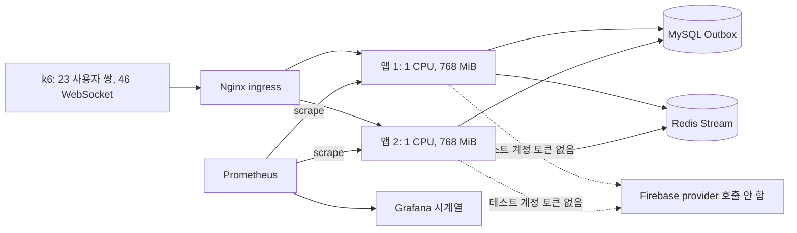
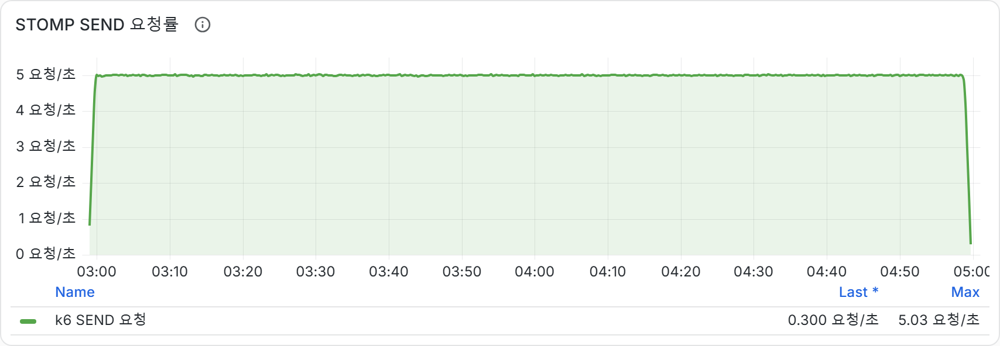
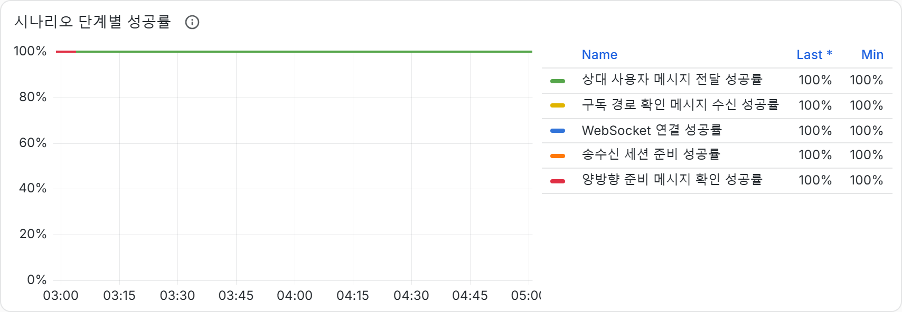
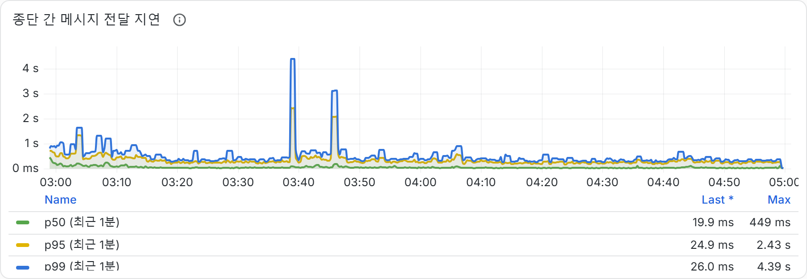
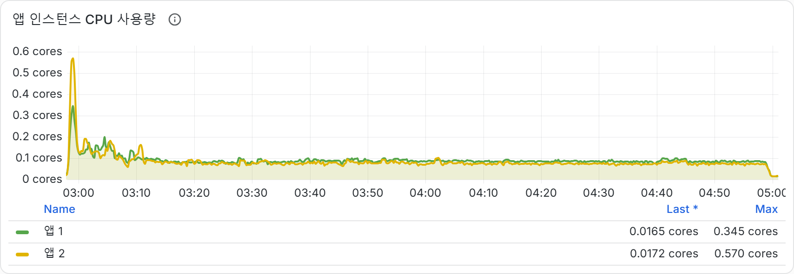
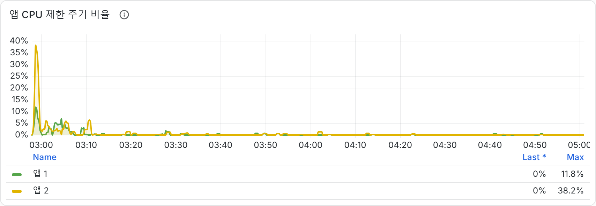
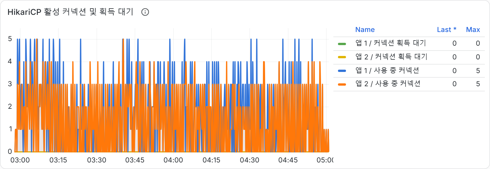
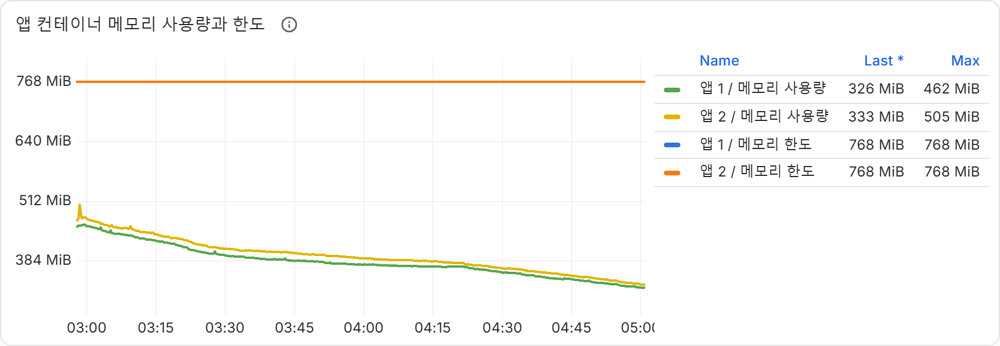
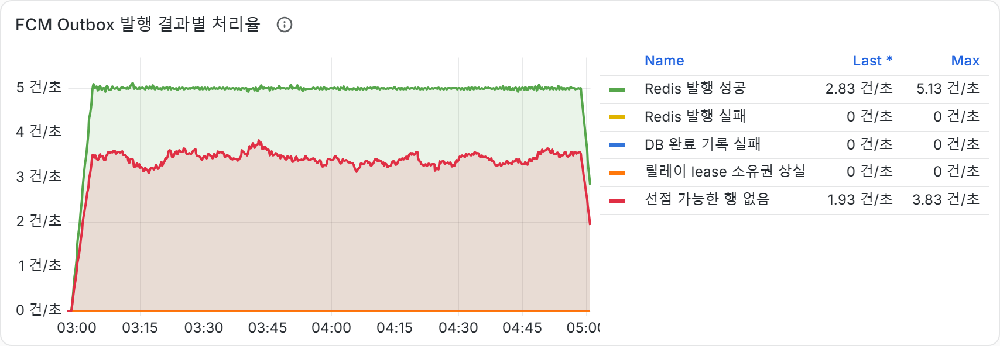

# 두 앱 서버의 지속 메시징 부하

## 측정 질문

앱 컨테이너를 각각 1 CPU와 768 MiB로 제한한 상태에서 Nginx 뒤의 두 앱이 5 SEND/s를 두 시간 동안 처리할 수 있는지, 메시지 전달과 JVM, DB pool, Redis Stream의 시간 흐름이 안정적인지 확인했습니다.

## 실행 조건

| 항목 | 값 |
| --- | --- |
| Run ID | `run-20261006-1pct-mau-ingress-5rps-120m-v10` |
| 부하 구간 | 2026-10-05 17:57:59–19:59:27 UTC, 약 2시간 |
| 부하 | 사용자 쌍 23개, WebSocket 46개, 목표 5 SEND/s |
| 앱 자원 상한 | 인스턴스별 CPU 1코어, 메모리 768 MiB |
| Firebase 기기 토큰 | 0개, provider 호출 없음 |
| 증거 | [실행 요약](evidence/sustained-load/summary.json), [실제 Grafana 캡처](evidence/sustained-load/) |

공개용 요약은 k6 결과 통계와 자원 경계만 남겼습니다. 원본 k6 파일의 setup fixture에는 테스트 계정 식별자와 bearer token 값이 들어 있어 포함하지 않았습니다.

## 전체 실행 결과

| 지표 | 결과 |
| --- | ---: |
| SEND | 35,995건 |
| SEND 요청률 | 평균 4.997/s |
| Guest 전달 성공률 | 100% |
| Guest 전달 지연 p50 / p95 / 최대 | 43 ms / 335 ms / 4,624 ms |
| HTTP 요청 실패 / dropped iteration | 0 / 0 |
| Nginx WebSocket upgrade 분포 | 앱 1 23건, 앱 2 23건 |
| Outbox 증가량 | 36,018행, 모두 `SENT`, `PENDING` 0 |
| Redis Stream lag / DLQ | 관측 lag 0, DLQ 0 |
| Hikari pending 최대 / active 최대 | 앱별 0 / 5 |

성공률과 지연은 전체 k6 run 결과입니다. 별도로 Grafana에서 확인한 18:52 UTC 시점 직전 15분의 guest 지연 p95는 439 ms였습니다. 전체 run과 최근 구간의 percentile을 같은 집계로 섞지 않았습니다.

보존된 k6 summary는 관측 집계값과 threshold 결과가 일치하지 않는 항목을 포함합니다. 또한 이 실행에 대응하는 runner manifest는 보존 자료에서 찾지 못했습니다. 따라서 이 문서는 35,995건, 전달 성공률, 지연, 자원 값을 관측값으로만 제시하며 k6 threshold 통과나 전체 실행 성공 판정을 주장하지 않습니다.

앱별 steady CPU 평균은 약 0.090, 0.077 core였습니다. 시작 구간 CPU 최고치는 0.345, 0.570 core였고 컨테이너 working set 최고치는 462, 505 MiB였습니다. 시작 구간 이후 CPU throttling은 대부분 0에 가까웠습니다. `claim_skipped`가 약 3건/s까지 관측돼 두 앱이 같은 outbox 후보를 읽고 claim 경합을 하는지 후속 조사 후보로 남겼습니다. 이 수치만으로 batch claim의 개선 효과를 주장하지 않습니다.

## 실제 Grafana 캡처

아래 파일은 2026-10-05에 실제 Grafana에서 가져온 1,708×592 픽셀 패널 캡처입니다. 캡처 메타데이터에는 기기 경로와 localhost URL이 포함돼 공개하지 않고, 필요한 시계열만 보존했습니다.

| 패널 | 캡처 |
| --- | --- |
| SEND 요청률 |  |
| 시나리오 성공률 |  |
| Guest 전달 지연 |  |
| 앱 CPU |  |
| CPU throttling |  |
| HikariCP |  |
| 컨테이너 메모리 |  |
| Outbox 발행 |  |

## 한계와 결론

- 이 실행은 로컬 Docker CFS 상한이며 AWS T3 CPU credit, OS 자원, 실제 두 EC2 호스트를 재현하지 않습니다. T3.micro 용량 증거로 사용할 수 없습니다.
- `SENT`와 Redis 전달은 Firebase provider 승인이나 실제 기기 도달을 뜻하지 않습니다. 테스트용 실제 기기 토큰이 없어 FCM 전송 성능은 측정하지 않았습니다.
- Nginx 101 분포는 시작 시 연결 배치를 보여 줍니다. 두 앱의 모든 요청이나 메시지 부하가 계속 50:50이었다는 증거가 아닙니다.
- 기록된 최대 메모리는 각 앱 컨테이너 값입니다. 서로 다른 시각의 peak를 더해 한 호스트의 동시 메모리로 해석하지 않습니다.

이 실행은 제한된 두 앱에서 5 SEND/s를 두 시간 공급했을 때의 안정성 관찰입니다. 서비스 최대 처리량이나 AWS 운영 성능으로 일반화하지 않습니다.
