# Redis Stream 소비자 스레드 모델 비교

## 질문

Redis Stream 소비 루프를 플랫폼 스레드와 가상 스레드로 각각 실행할 때, CPU가 제한된 두 앱에서 전달 성공률, 지연, queue backlog가 어떻게 달라지는지 비교했습니다. 첫 쌍의 방향만 보고 모델 우열을 결론 내리지 않도록 실행 순서를 뒤집어 한 차례 반복했습니다.

## 조건과 범위

- 두 앱, 앱별 CPU quota 1코어와 메모리 768 MiB
- 동일 이미지 digest `c226b0c73146`, reader 4개, 23개 사용자 쌍, nominal 25 SEND/s, 각 부하 구간 300초
- Docker 기반 로컬 실행이며 AWS T3.micro 측정이 아닙니다.
- Redis Stream lag와 PEL은 전역 수치이며 실행 ID label이 없습니다. run별 인과 효과로 귀속하지 않습니다.
- 해당 소스와 Compose는 2026-10-08 실행 당시 상태입니다. 현재 코드의 성능 검증으로 표현하지 않습니다.

## 같은 reader 수로 맞춘 결과

| 지표 | 첫 비교: 플랫폼 | 첫 비교: 가상 | 역순 반복: 플랫폼 | 역순 반복: 가상 |
| --- | ---: | ---: | ---: | ---: |
| Guest 전달 | 5,785/7,498 (77.15%) | 7,498/7,498 (100%) | 6,971/7,498 (92.97%) | 6,440/7,498 (85.89%) |
| k6 Guest 전달 p95 | 4.096 s | 1.315 s | 4.266 s | 4.287 s |
| Redis lag 최고 관측 | 1 | 141 | 1 | 87 |
| Redis PEL 최고 관측 | 20 | 80 | 16 | 80 |
| k6 threshold 기록 | 실패 | 판정 불일치 | 실패 | 실패 |

네 실행 모두 Hikari 대기는 0으로 관측됐습니다. CFS throttling은 양쪽에서 최대 약 98%까지 치솟았습니다. 이 실행에서 CPU 제한은 분명한 동시 조건이며, 가상 스레드가 CPU 부족을 해결한다고 볼 수 없습니다.

첫 비교의 전달 성공률과 p95는 가상 스레드 쪽이 높았지만, 역순 반복에서는 플랫폼 쪽 성공률이 높아졌고 p95는 거의 같았습니다. 첫 가상 실행은 runner manifest가 threshold 통과로 기록한 반면 함께 저장된 k6 요약 JSON은 threshold 실패로 표시합니다. 따라서 표의 "판정 불일치"는 설정된 기준을 통과했다는 주장이 아닙니다. 결과 방향도 반복에서 뒤집히므로 현재 표본으로 승자를 선언하지 않습니다. 필요한 다음 검증은 동일한 현재 이미지로 여러 순서를 교차한 반복이며, CPU headroom을 확보한 조건과 quota 포화 조건을 별도 분석하는 것입니다.

## 실제 Grafana 캡처

각 실행의 시나리오 성공률, 지연, CPU throttling, JVM 플랫폼 스레드 수와 Redis lag/PEL 패널을 보존했습니다. 그래프는 단일 평균 대신 실행 중 시간 변화를 보여 줍니다.

### 첫 비교

| 모델 | 성공률 | CPU 제한 주기 | Redis backlog |
| --- | --- | --- | --- |
| 플랫폼 | 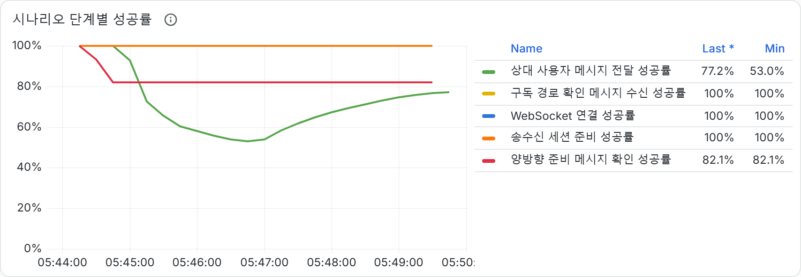 | 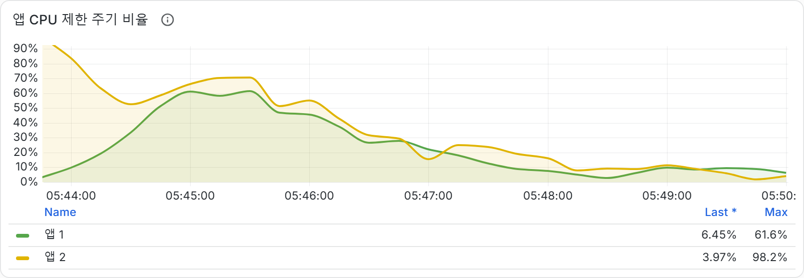 | 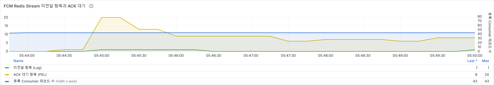 |
| 가상 | 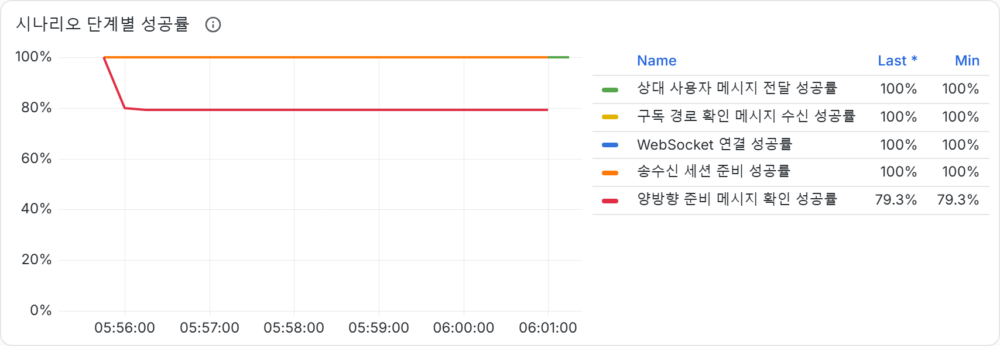 | 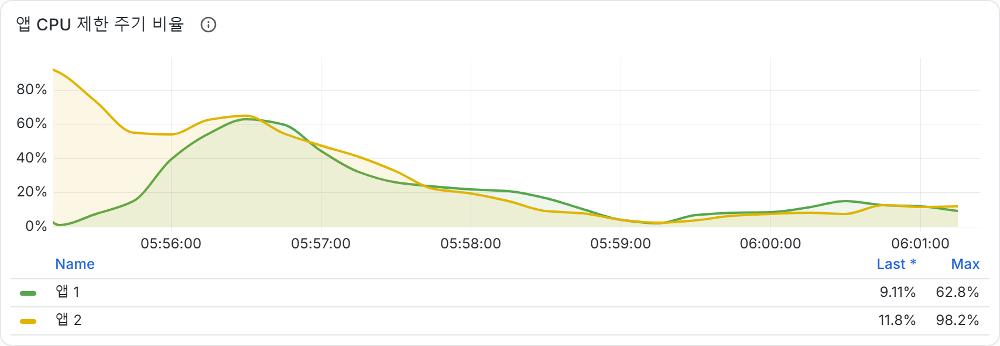 | 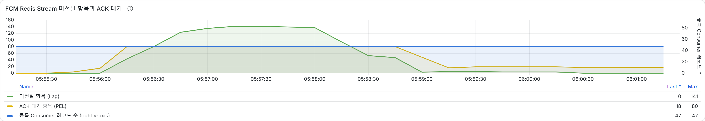 |

### 실행 순서를 바꾼 반복

| 모델 | 성공률 | Guest 전달 지연 |
| --- | --- | --- |
| 플랫폼 | 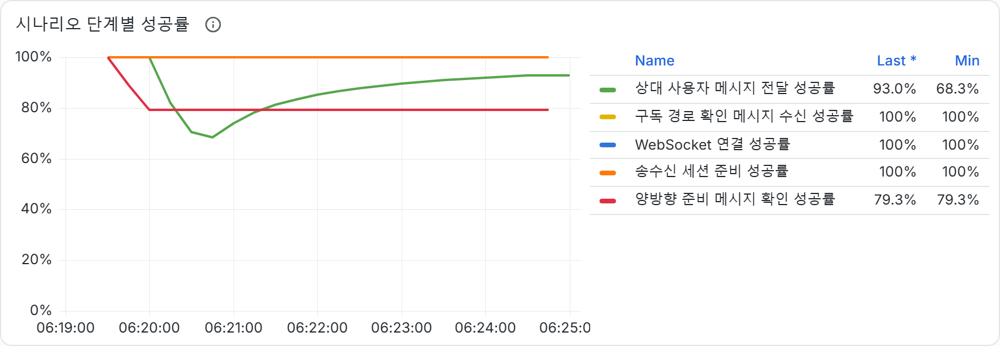 | 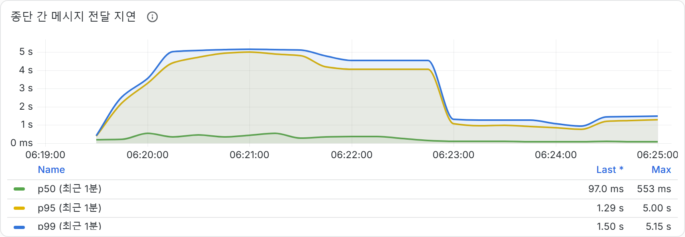 |
| 가상 | 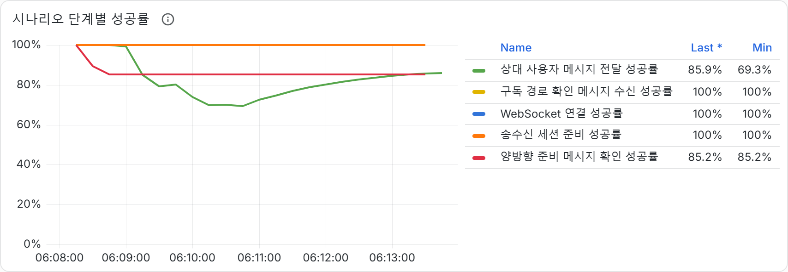 | 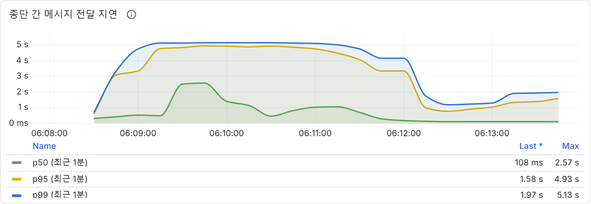 |

첫 비교의 JVM 플랫폼 스레드 수: [플랫폼 설정](evidence/thread-model/first-platform-jvm-threads.png), [가상 설정](evidence/thread-model/first-virtual-jvm-threads.png).

원본 run 식별과 조회 시간은 [실행 기록](evidence/thread-model-comparison.md)에 있습니다. 로컬 브라우저 경로와 localhost URL이 포함된 capture manifest는 공개 트리에 넣지 않았습니다.

## 모델별 운영 프로파일 후보

앞의 비교는 reader 수를 4개로 고정해 소비자 스레드 모델 차이를 관찰했습니다. 운영 설정 후보를 찾는 별도 실행에서는 모델별 설정을 다르게 두었습니다. 플랫폼 스레드는 reader 1개, 가상 스레드는 reader 4개를 사용했습니다. 이 결과는 서로 다른 설정 묶음의 관측값이며 스레드 모델 하나의 효과로 해석하지 않습니다.

| 지표 | 플랫폼 reader 1 | 가상 reader 4 |
| --- | ---: | ---: |
| 앱 자원 제한 | CPU quota 0.20, 메모리 768 MiB | CPU quota 0.20, 메모리 768 MiB |
| 부하 | 23쌍, 5 SEND/s, 300초 | 23쌍, 5 SEND/s, 300초 |
| Guest 전달 | 1,518/1,518 (100%) | 1,518/1,518 (100%) |
| k6 종단간 전달 p95 | 1,374 ms | 1,958 ms |
| CPU 제한 주기 최고 관측 | 약 100% | 약 100% |
| Hikari 대기 | 0 | 0 |
| 전역 Redis lag 및 PEL 최고 관측 | 216, 20 | 54, 80 |
| 종료 후 전역 Redis lag 및 PEL | 2, 4 | 0, 1 |
| 저장된 threshold 판정 | manifest 통과, k6 JSON 실패 | manifest 통과, k6 JSON 실패 |

두 프로파일 모두 300초 동안 관측된 전달은 완료했지만 CPU 제한 주기가 거의 모두 포화됐습니다. 표의 p95는 k6 전체 실행 구간의 집계이고, 아래 Grafana 패널은 시간에 따른 rolling percentile을 보여 줍니다. runner manifest는 두 실행 모두 threshold 통과로 기록했지만 원본 k6 JSON은 false threshold를 포함합니다. 판정 불일치가 해소되기 전에는 threshold 통과라고 주장하지 않고, 집계된 전달 수와 지연만 관측값으로 사용합니다. 플랫폼 프로파일의 p95가 이 실행에서 더 낮았다는 사실만으로 플랫폼 스레드의 우위를 결론 내릴 수는 없습니다. reader 수와 전역 Redis backlog가 다르고 각 프로파일을 한 번씩만 실행했습니다. 각 조건은 현재 자원 한도 안에서 다시 검증할 후보로만 봅니다.

### 플랫폼 reader 1

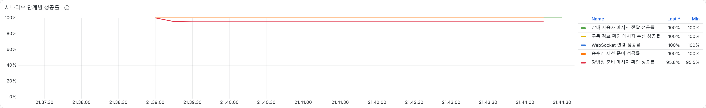

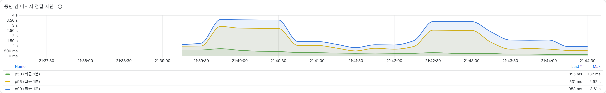

[CPU throttling 그래프](evidence/thread-model/profile-platform-reader1-throttling.png), [Redis lag와 PEL 그래프](evidence/thread-model/profile-platform-reader1-redis-backlog.png)

### 가상 reader 4

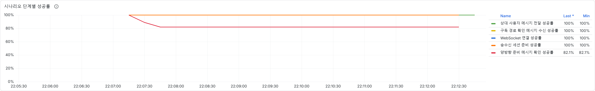

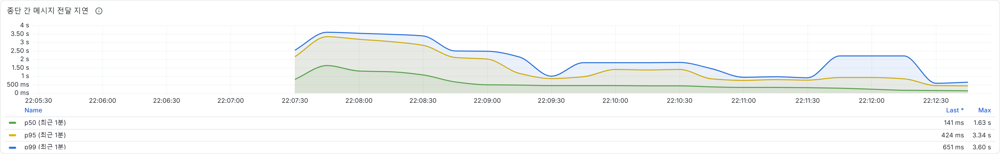

[CPU throttling 그래프](evidence/thread-model/profile-virtual-reader4-throttling.png), [Redis lag와 PEL 그래프](evidence/thread-model/profile-virtual-reader4-redis-backlog.png)

## 해석 제한

- 실행은 Redis 소비자 reader 설정 비교이지 Spring 서버 전체의 executor 모델 비교가 아닙니다.
- Redis lag와 PEL은 전역 상태로, 전후 실행에서 공유된 backlog가 다음 실행에 영향을 줄 수 있습니다.
- 각 설정의 반복 횟수가 적고 두 반복에서 결과가 뒤집혔습니다. 통계적 유의성이나 일반적인 처리량 우위를 주장하지 않습니다.
- runner manifest의 threshold 상태와 일부 k6 summary JSON의 threshold 상태가 일치하지 않습니다. manifest는 종료 코드 0만으로 통과를 기록하므로 판정 상태를 재사용하지 않고 관측 집계값만 인용합니다.
- 테스트 계정에는 Firebase 기기 토큰이 없습니다. provider 승인과 단말 수신을 측정하지 않았습니다.
